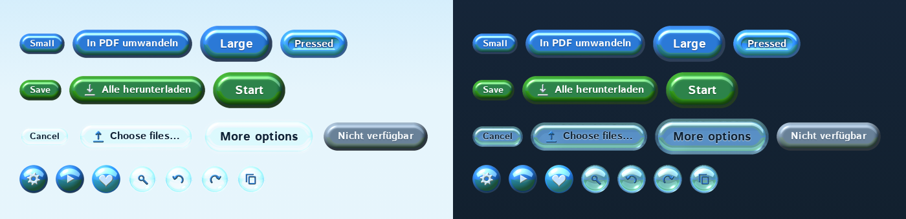
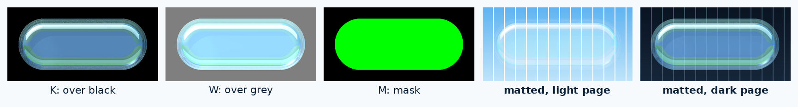
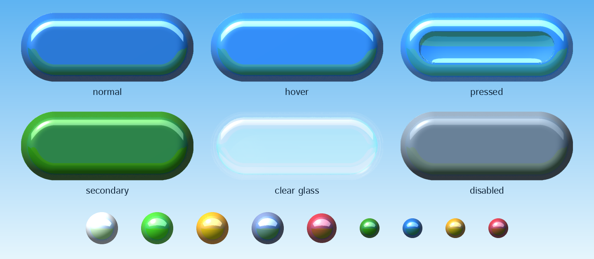

# Aerolith

Frutiger Aero for the web. Every button, field, pane, icon and title letter is a Bryce 2 render
(1996), laid over plain HTML elements.

**[Live showcase](https://immineal.github.io/aerolith/)** · [npm](https://www.npmjs.com/package/aerolith) · [Changelog](CHANGELOG.md)



## Use it

No build step:

```html
<link rel="stylesheet" href="https://cdn.jsdelivr.net/npm/aerolith@1/library/dist/aerolith.css">
<script src="https://cdn.jsdelivr.net/npm/aerolith@1/library/dist/aerolith.js" defer></script>
```

```html
<button class="aer-button">Convert to PDF</button>
<button class="aer-button aer-secondary aer-l">Start</button>
<button class="aer-button aer-quiet">Cancel</button>

<label class="aer-option"><input type="checkbox" role="switch" class="aer-toggle"> Keep metadata</label>
<label class="aer-label">File name <input class="aer-field" value="report.pdf"></label>
<progress class="aer-progress" max="100" value="62">62%</progress>

<button class="aer-iconbtn" aria-label="Settings">
  <span class="aer-icon aer-icon-gear" aria-hidden="true"></span>
</button>
```

`class="aer"` on `<body>` adds the focus ring and reduced-motion rules. The showcase source has an
example of every component. Self-hosting: keep `sprites/` and `fonts/` next to `aerolith.css`.

| Where | Install | Then |
|---|---|---|
| npm | `npm i aerolith` | `import "aerolith/aerolith.css"` (and `aerolith/aerolith.js`) |
| GitHub Packages | `npm i @immineal/aerolith --registry=https://npm.pkg.github.com` | same |
| Composer | `composer require immineal/aerolith` | serve `vendor/immineal/aerolith/library/dist/` |
| PyPI | `pip install aerolith` | `aerolith.static_dir()`; Django: add `"aerolith"` to `INSTALLED_APPS` |
| CDN | jsDelivr, unpkg, esm.sh | or `cdn.jsdelivr.net/gh/immineal/aerolith@v1.1.0/library/dist/aerolith.css` |

React, Vue, Svelte, Astro: import the CSS once in your entry file and use the classes
(`className` in JSX). Content added after load needs `window.Aerolith.init(container)`.

## Components

| Class | On | States |
|---|---|---|
| `.aer-button` (+ `.aer-secondary`, `.aer-quiet`; `.aer-s`, `.aer-l`) | `<button>`, `<a>` | hover, pressed, `aria-pressed`, disabled |
| `.aer-iconbtn` (+ `.aer-quiet`) | `<button>` with an `.aer-icon` | hover, pressed |
| `.aer-icon .aer-icon-<name>` (+ `.aer-s`, `.aer-pearl`) | `<span aria-hidden="true">` | 35 glyphs, 24/16 px |
| `.aer-toggle` (+ `.aer-theme`) | `<input type="checkbox" role="switch">` | on, disabled |
| `.aer-check`, `.aer-radio` | checkbox, radio | checked, mixed, disabled |
| `.aer-field` | `<input>`, `<textarea>`, `<select>` | focus, disabled |
| `.aer-select` | wrapper around `select.aer-field` | |
| `.aer-segmented` | radios in labels, or links with `aria-current` | hover, selected |
| `.aer-choice` | `<label>` with a radio or checkbox | hover, checked, focus |
| `.aer-drop` | `<label>` with `<input type="file">` | drag-over, focus |
| `.aer-progress` | `<progress>` | value |
| `.aer-slider` | wrapper around `<input type="range">` | value (fill needs the JS) |
| `.aer-spinner` | `<span role="status" aria-label="…">` | 8-frame animation |
| `.aer-badge`, `.aer-orb` (+ `.aer-info`, `.aer-warn`, `.aer-error`) | any inline element | |
| `.aer-callout` (+ status colours), `.aer-toast` in `.aer-toaster` | any block | |
| `.aer-panel`, `.aer-card` | any block | card hover on links/buttons |
| `.aer-dialog`, `.aer-close` | `<dialog>`, `<button>` | open, backdrop |
| `.aer-popover`, `.aer-menu` | `[popover]` | item hover/focus |
| `.aer-bar` | `<header>`, `<nav>` | |
| `.aer-lens` | any block | rim refraction in Chromium |
| `.aer-compare` | two `` and an `<input type="range">` | |
| `.aer-display` (+ `.aer-aqua`, `.aer-glass`, `.aer-pearl`) | any heading | 116 characters |

### Type

```html
<h1 class="aer-display">Welcome back</h1>            <!-- aqua; glass on dark pages -->
<h2 class="aer-display aer-glass">Photos</h2>        <!-- clear glass: needs colour behind it -->
<p class="aer-display aer-pearl">Ready</p>           <!-- white, for coloured backgrounds -->
```

Aerolith Display is a colour font of rendered gel letters, so titles stay real, selectable text.
Use it from 32 px up. Each material is about 0.6 MB, loaded only where used. Browsers without
colour fonts show heavy Istok.

Body text is **Istok Web**. `data-aer-type="selawik"` switches to **Selawik**, an open Segoe UI
stand-in. Dark mode follows the system; `data-theme="dark"` or `"light"` on `<html>` forces it,
and the sun/moon switch (`input[data-aer-theme]`) sets that for you.

## Accessibility

Real form controls sit under every skin, so keyboards, screen readers and autofill work as usual.

- Label contrast, measured on the rendered pixels: white on aqua 4.4:1, white on green 4.7:1,
  dark on glass 4.6:1 or better. Hover states measure 3.3 to 3.6:1 without their halo, pressed
  about 2.4:1. There the look won. `python3 library/build/a11y.py` prints every number.
- Controls are 44 px high; small ones get a 44 px hit area.
- `forced-colors` swaps the sprites for system colours. `prefers-reduced-motion` stops the
  animations.

## How it's made



Bryce 2.1 runs under Wine on virtual displays, seven at once. Python writes each scene as a
`.brc` file; I reverse-engineered the format in [docs/brc-format.md](docs/brc-format.md). Each
sprite is rendered alone, three times: over black (colour and glints), over grey (how much light
the glass lets through) and as a flat mask. From those the build makes PNGs where gloss is solid
and glass is see-through.



Behind the camera is a sky and a meadow with two hills, so every button reflects blue on top and
green below. The shapes are height fields computed in NumPy. The CSS draws sprites with
`border-image`.

To render new sprites you need Wine and your own copy of Bryce 2 (not included):

```sh
cd library/build
python3 build.py              # renders what changed, exports to dist/
python3 build.py btn-         # only sprites starting with btn-
python3 build.py --export-only
```

Setup: [harness/README.md](harness/README.md). Design rules:
[docs/ui-library/foundations.md](docs/ui-library/foundations.md).

## What it does not do

- **No colour picker.** Colours are baked into the renders.
- **Three heights.** 32, 44 or 56 px; buttons stretch sideways only.
- **The lens bends light only in Chromium.** Firefox and Safari show plain glass.
- **No framework components.** Put the classes on your own elements.
- **Bitmap icons and titles.** Icons are 16 and 24 px. Titles are sharp up to about 120 px and
  cover Latin with German and French accents.

## License

MIT for code and sprites ([LICENSE](LICENSE)). Fonts in `library/dist/fonts/` are SIL OFL 1.1:
Istok Web (Andrey V. Panov) and Selawik (Microsoft) unmodified, Aerolith Display derived from
Istok Web Bold. Bryce is a trademark of its owner; Aerolith is not affiliated and contains no
Bryce code.
